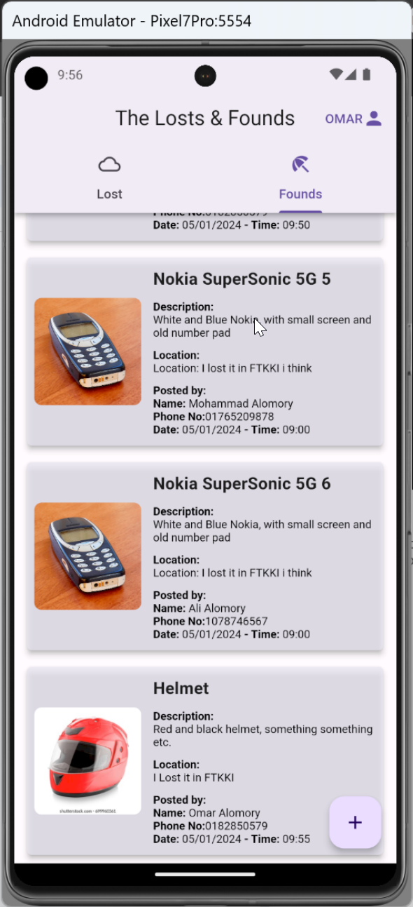
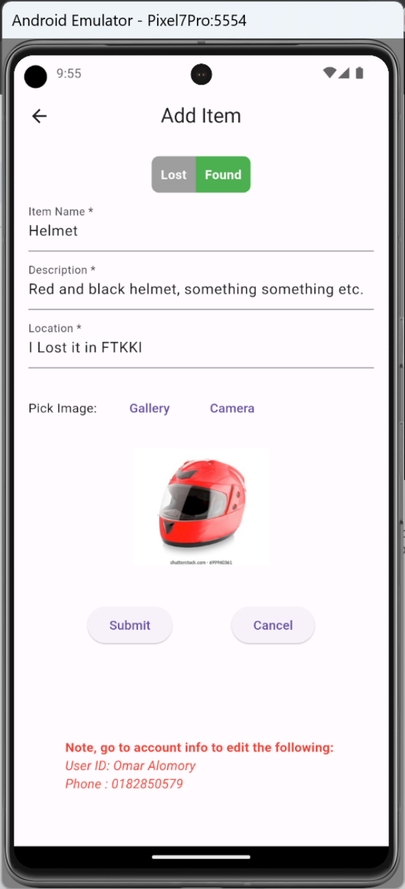
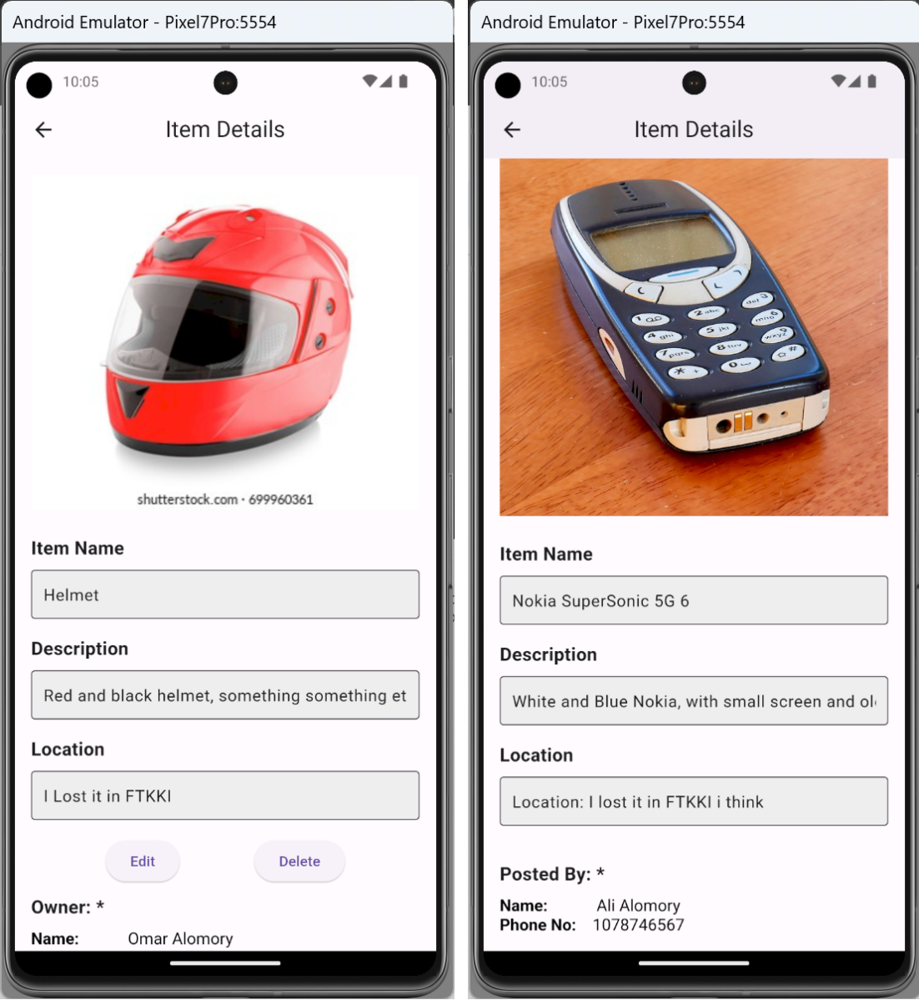

# Lost & Found App

A Flutter application for reporting lost and found belongings. Users can create an account, browse separate lost and found listings, and submit reports for items.

## Screenshots

<table>
  <tr>
    <td colspan="2" align="center">
      
      <br />
      <sub><b>Authentication</b></sub>
      <div style="height: 30px;"></div>
    </td>
  </tr>
  <tr>
    <td align="center">
      
      <br/>
      <sub><b>Item listings</b></sub>
      <div style="height: 30px;"></div>
    </td>
    <td align="center">
      
      <br/>
      <sub><b>Report a lost or found item</b></sub>
      <div style="height: 30px;"></div>
    </td>
  </tr>
  <tr>
    <td colspan="2" align="center">
      
      <br/>
      <sub><b>Lost or found item detail</b></sub>
      <div style="height: 30px;"></div>
    </td>
  </tr>
</table>

<!-- 

 

 -->

## Features

- Account registration and sign-in.
- Separate views for lost and found items.
- Item reporting for lost and found belongings.
- SQLite and Firebase integration for application data.

## Technology

- Flutter and Dart
- SQLite
- Firebase

## Run locally

**Requirements:** Flutter SDK, an Android or iOS development environment, and access to the Firebase project configuration used by the app.

From the project root:

```bash
flutter pub get
flutter run
```

To build a release APK:

```bash
flutter build apk --release
```

Firebase must be configured for the target platform before running the application. Keep private credentials and signing keys out of version control.

## Project structure

The application code and reusable UI are organised under `lib/`; static resources and app screenshots are kept under `assets/`.

```text
lib/
├── data/
├── model/
├── screens/
└── widgets/

assets/
├── images/
└── screenshots/
```

## License

Distributed under the MIT License. See [LICENSE](LICENSE).
