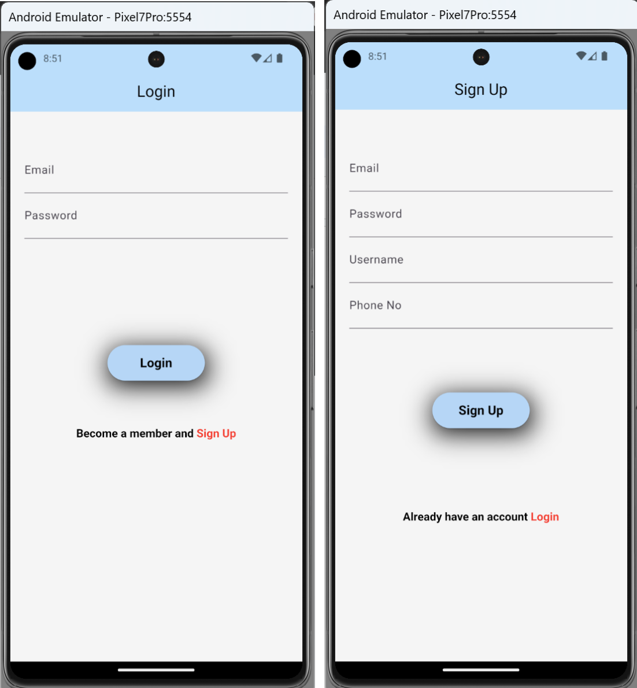

# Lost & Found App

A modern, offline-first Flutter application for tracking, reporting, and reclaiming lost and found belongings. Users can authenticate, browse categorized lost and found listings, report items with photos, and synchronize data with remote endpoints automatically when network connectivity is available.

## Screenshots

<table>
  <tr>
    <td colspan="2" align="center">
      
      <br />
      <sub><b>Authentication</b></sub>
      <div style="height: 30px;"></div>
    </td>
  </tr>
  <tr>
    <td align="center">
      
      <br/>
      <sub><b>Item listings</b></sub>
      <div style="height: 30px;"></div>
    </td>
    <td align="center">
      
      <br/>
      <sub><b>Report a lost or found item</b></sub>
      <div style="height: 30px;"></div>
    </td>
  </tr>
  <tr>
    <td colspan="2" align="center">
      
      <br/>
      <sub><b>Lost or found item detail</b></sub>
      <div style="height: 30px;"></div>
    </td>
  </tr>
</table>

## Features

- **Secure Authentication**: Registration and sign-in with SHA-256 password hashing.
- **Offline-First SQLite Storage**: All reports and account data are saved locally in SQLite (`sqflite`). The app works seamlessly without an internet connection.
- **Automatic Online Sync**: Listens to connectivity changes (`connectivity_plus`) and automatically synchronizes pending local reports and fetches remote updates when connection returns.
- **Categorized Tabs**: Distinct views for Lost and Found items with real-time counters.
- **Instant Search**: Filter items in real time by name, description, location, or poster.
- **Photo Attachments**: Capture from Camera or select from Gallery; images are safely persisted in app storage.
- **Listing Management**: Item posters can edit or delete their own reports.
- **Modern Material 3 UI**: Clean cards, rounded segmented buttons, status badges, hero transitions, and floating notifications.

## Technology Stack

- **Framework**: Flutter 3 (Material 3 enabled) & Dart 3
- **Local Persistence**: `sqflite`, `path`, `path_provider`
- **State Management**: `provider`
- **Network & Connectivity**: `connectivity_plus`, `http`
- **Security**: `crypto` (SHA-256)
- **Formatting**: `intl`

## Run Locally

**Requirements:** Flutter SDK (3.x or later) and an Android or iOS emulator/device.

From the project root:

```bash
# 1. Fetch dependencies
flutter pub get

# 2. Run static analyzer (0 warnings standard)
flutter analyze

# 3. Run automated unit & widget tests
flutter test

# 4. Run the app
flutter run
```

To build a release APK for Android:

```bash
flutter build apk --release
```

## Project Structure

```text
lib/
├── main.dart                      # Application root & theme config
├── model/                         # User & Item data entities
│   ├── item.dart
│   └── user.dart
├── providers/                     # State management
│   └── app_provider.dart
├── screens/                       # App screens
│   ├── add_item.dart
│   ├── auth_screen.dart
│   ├── home_screen.dart
│   └── item_details.dart
├── services/                      # SQLite & Remote sync services
│   ├── database_helper.dart
│   └── remote_sync_service.dart
├── theme/                         # Material 3 design system
│   └── app_theme.dart
├── util.dart                      # Notification helpers
└── widgets/                       # Reusable UI widgets
    ├── item_card.dart
    └── item_image.dart

test/
└── app_test.dart                  # Automated tests
```

## License

Distributed under the MIT License. See [LICENSE](LICENSE).
